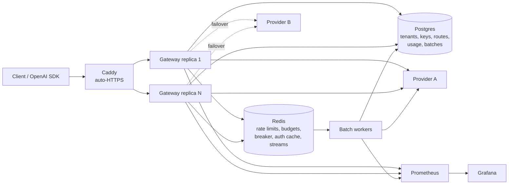

# llm-gateway

[](https://github.com/Emonemon74/llm-gateway/actions/workflows/ci.yml)

A multi-tenant, **OpenAI-compatible** gateway that sits in front of LLM providers (Groq, Gemini,
Cerebras, any OpenAI-style upstream). Point the stock OpenAI SDK at it and get per-tenant auth,
distributed rate limits, token budgets, automatic failover, a durable batch API and production
metrics, without changing client code.

```python
from openai import OpenAI

client = OpenAI(base_url="https://<your-gateway>/v1", api_key="sk-gw-...")
client.chat.completions.create(model="smart", messages=[{"role": "user", "content": "hi"}])
```

## Highlights (measured, see [docs/benchmarks.md](docs/benchmarks.md))

| | Result |
|---|---|
| **Failover under load** | Primary provider returned 500 for 25 s of a 60 s run at 200 req/s: **12,000 / 12,000 requests succeeded**. Circuit opened 0.3 s after the outage began and closed 0.5 s after recovery. |
| **Distributed rate limit** | 600 req/min key hit across **3 replicas**: allowed 799 vs theoretical 800 (-0.12%). The limit is global because the token bucket lives in Redis (atomic Lua). |
| **Gateway overhead** | p95 **8-16 ms** added at 200-300 req/s on one replica (p50 2-3.5 ms). Auth cache cut p50 ~30%. |
| **Overload** | One replica saturates ~1 core near 350 req/s. Load shedding turned overload from client timeouts into fast 503s: goodput **+56-67% at 500/s**, timeouts thousands to ~0. |
| **Batch API** | Chaos-tested with real processes: `kill -9` workers and `FLUSHALL` Redis mid-batch. A 400-item batch completes with every result recorded **exactly once**. |
| **Tests** | 103 tests (unit, integration, contract, chaos) run in CI against real Postgres + Redis. |

Honest caveats (laptop-only load tests, unsolved overload tail latency, no horizontal-scaling
number yet) are listed in [docs/benchmarks.md](docs/benchmarks.md).

## Architecture



Request path for `POST /v1/chat/completions`:

1. **Authenticate**: SHA-256 hashed API key, cached in Redis (30 s hit / 10 s miss, invalidated on revoke).
2. **Rate limit**: Redis Lua token bucket for RPM and TPM, atomic, using Redis `TIME` so replicas share one clock.
3. **Budget**: reserve estimated tokens, reconcile with actual usage afterwards; counters rebuild from Postgres.
4. **Route**: alias maps to an ordered provider list; a shared circuit breaker (closed / open / half-open with a single probe) skips unhealthy providers.
5. **Stream or return**: SSE is passed through; failover is possible only before the first byte.
6. **Account**: usage events go through a queue to batched Postgres inserts; metrics are emitted with bounded label cardinality.

All state lives in Redis and Postgres, so the gateway scales by adding replicas.

## Features

- OpenAI-compatible `/v1/chat/completions` (+ streaming), error envelope in OpenAI format
- Multi-tenant: tenants, hashed API keys, per-key RPM/TPM limits and monthly token budgets
- Model aliases with ordered failover; `x-gateway-provider` and `x-request-id` on every response
- Durable **batch API** on Redis Streams: at-least-once delivery, exactly-once result recording,
  full-jitter backoff, dead-letter queue, crash recovery, reconciler, separate rate-limit bucket
- Load shedding (event-loop lag + in-flight cap) as pure ASGI middleware
- Prometheus metrics and a provisioned Grafana dashboard (gateway-added latency, failovers, circuit state, 429s, per-tenant cost)
- Production deploy: multi-stage Docker image (non-root), Compose stack, Caddy HTTPS, admin endpoints not exposed publicly

## Quick start

```bash
uv sync
uv run uvicorn mock_provider.main:app --port 9000 &     # fake upstream
uv run uvicorn app.main:app --port 8000                 # gateway
curl localhost:8000/v1/chat/completions -H 'content-type: application/json' \
  -d '{"model":"mock/test","messages":[{"role":"user","content":"hi"}]}'
uv run pytest
```

Postgres and Redis for local dev: `docker compose -f deploy/docker-compose.yml up -d`
(also starts Prometheus :9090 and Grafana :3000).

## Using it

**Routing and failover**
```bash
# alias "smart": try provider alpha first, fall back to beta
curl -XPOST localhost:8000/admin/routes -H "Authorization: Bearer $ADMIN_TOKEN" \
  -H 'content-type: application/json' \
  -d '{"alias":"smart","provider":"alpha","upstream_model":"m","priority":0}'
```
Extra OpenAI-compatible upstreams: `EXTRA_PROVIDERS='{"alpha":{"base_url":"http://...","api_key":"..."}}'`.
A later upstream failure during a stream ends it with an SSE error event.

**Batch API**
```bash
curl -XPOST localhost:8000/v1/batches -H "Authorization: Bearer $KEY" -H "Idempotency-Key: job-1" \
  -H 'content-type: application/json' \
  -d '{"requests":[{"custom_id":"a","body":{"model":"smart","messages":[{"role":"user","content":"hi"}]}}]}'
curl localhost:8000/v1/batches/$ID            # progress
curl localhost:8000/v1/batches/$ID/results    # NDJSON, submission order
uv run python -m app.batch.worker             # run one or more workers
```

**Delivery guarantees.** A message is acked only after its outcome is durable in Postgres; a dead
worker's messages are reclaimed via `XAUTOCLAIM`. Completion is a conditional `UPDATE`, so duplicate
deliveries cannot double-write or double-count. The upstream call itself can repeat for work that
was in flight when a worker died. An open circuit or a rate limit *defers* an item without burning
an attempt. Postgres is the source of truth: a reconciler re-enqueues anything Redis forgot.

**Observability.** `/metrics` requires the admin token. Key series: `gateway_overhead_seconds`,
`gateway_upstream_requests_total{outcome}`, `gateway_circuit_state`, `gateway_rate_limited_total`,
per-tenant token and cost counters. Demo traffic: `uv run python loadtest/demo_traffic.py 30`.

## Load testing

k6 with an open-model (constant-arrival-rate) executor so overload shows up as latency and errors
rather than a silently lower request rate:

```bash
uv run python loadtest/run_load_test.py sweep       # throughput sweep, one replica
uv run python loadtest/run_load_test.py failover    # kill a provider mid-run
uv run python loadtest/run_load_test.py ratelimit   # accuracy across replicas
```

## Deploy

Dockerfile + production Compose stack (Postgres, Redis, API, batch worker, Prometheus, Grafana,
Caddy with automatic HTTPS) are in `deploy/`. Step-by-step EC2 guide: [docs/DEPLOY.md](docs/DEPLOY.md).

## Project layout

```
app/           gateway: api/, limits/, routing/, batch/, db/, metrics, shedding
mock_provider/ configurable fake upstream (latency, errors) for tests and load tests
tests/         unit, integration, contract, chaos
loadtest/      k6 scripts and the harness
deploy/        Docker Compose (dev + prod), Caddy, Prometheus, Grafana
docs/          PLAN.md (design), benchmarks.md, DEPLOY.md
```

Design and roadmap: [docs/PLAN.md](docs/PLAN.md).

## Known limits

- Load numbers come from a single laptop (see caveats in benchmarks); no multi-replica scaling figure yet.
- Under heavy overload, p95 of *successful* requests is still 1.5-3.9 s (queueing precedes the shedding check).
- Stock Caddy has no connection limiting; overload protection is the in-app shedder.
- Semantic cache and tracing are not implemented.
